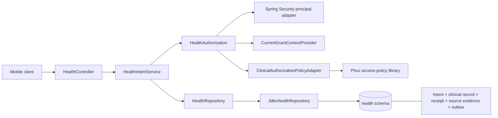

# Khanh M2 Health Service Contribution

## Scope and completion status

This section records Khanh's M2 slice: the Health service requirements, API contract, domain and persistence implementation, authorization boundary, tests, and architecture write-up. The service owns clinical intents, immutable health records, receipts, source evidence, and current Health-side cattle custody data. It does not read another service's database.

| Assignment item | Local artifact/status |
|---|---|
| KHANH-R0 design/review packet | Prepared in [`health-a4-packet.md`](../engineering/health-a4-packet.md). It is ready for group review; no external message was sent. |
| KHANH-01 requirements and API | FR/AC/use cases and OpenAPI v1 are in this report and the contract file. Consumer review is still needed; no external review message was sent. |
| KHANH-02 domain and architecture | Health modules, policy/resource mapping, and logical view are implemented and documented below. |
| KHANH-03 schema and transaction | Flyway V1/V2 and atomic intent/record/receipt/evidence/outbox persistence are implemented. |
| KHANH-04 retry/concurrency/schedule | Unique idempotency claim, row locks, expected-version guard, scheduled-dose uniqueness, and linked corrections are implemented. |
| KHANH-05 authorization and access | Phuc's policy is called through a concrete adapter. Phu's verified identity/current-grant provider remains an integration dependency; default behavior fails closed. |
| KHANH-06 tests and write-up | PostgreSQL/HTTP tests and this report are added. Test execution is Not Run because required local tooling is absent. |

The Health API and database implementation are present on `Khanh_Health-Check`. Phuc's existing `access-policy` module was added unchanged to the local Maven reactor so the Health adapter can call the real policy implementation. The verified identity and production current-grant adapter from Phu are not in this checkout. Health therefore fails closed until that adapter supplies a verified principal and current grants: an unauthenticated request receives 401, and a missing grant or policy authority receives 503 with no effect. A synthetic grant file can be explicitly enabled for local demonstration only; it is disabled by default and re-read for each request.

## M2 requirement delta

M1 already required animal vaccination, health status, and treatment history. The M2 pressure is recording those facts beside the animal with a mobile client and RFID reader while preserving the permanent RFID identity, server authorization, auditability, and retry safety.

| Requirement | Health service behavior |
|---|---|
| FR-HH-01 Cattle lookup | Resolve one known RFID to a permanent cattle ID and canonical current farm, barn, and resource versions. Unknown and unverified tags are not auto-created. |
| FR-HH-02 Health intent | Accept vaccination, health-status, and treatment payloads with intent ID, occurrence time, device reference, and expected resource version. |
| FR-HH-03 Idempotent retry | Same intent ID and canonical payload returns the stored receipt; changed payload with the same ID conflicts. A unique key and PostgreSQL `ON CONFLICT DO NOTHING` serialize concurrent claims. |
| FR-HH-04 Receipt and history | Query a durable receipt by intent ID and list records by cattle/version. Every receipt lookup uses current `READ_RECEIPT`; history rows are filtered one by one with `READ_HISTORY`. |
| FR-HH-05 Current custody and version | Lock the cattle and custody rows before the final decision. A stale expected resource version is recorded as `NEEDS_REVIEW`; no clinical record is added. |
| FR-HH-06 Scheduled dose | A schedule has at most one effective completion. A repeated dose is recorded as `REJECTED`; a correction moves the effective pointer while preserving the old record. |
| FR-HH-07 Corrections | Append a linked record with `correctionOfRecordId` and a reason. The old clinical row is never updated, and the first-acceptance origin farm is retained. |
| NFR-HH-01 Access control | The application calls the verified-principal boundary and Phuc's clinical policy for lookup, submit, receipt, and history actions. Missing authority fails closed. |
| NFR-HH-02 Audit/no-loss | The clinical row, operation receipt, local source evidence, and audit outbox are committed in one database transaction. Any required evidence write failure rolls back the clinical effect. |

## FR, acceptance criteria, and use cases

### Acceptance criteria

- Lookup returns only one known animal by permanent RFID, after a `VIEW_CATTLE` decision over the server-resolved cattle and current custody.
- A new health submission receives 201 only after the current grant is checked again with the cattle row locked and the clinical record, receipt, source evidence, and audit outbox commit together.
- A retry with the same intent ID and payload returns 200 and the original outcome without a second record or evidence row.
- A retry with a changed payload returns 409 and does not change the stored outcome.
- A resource-version or schedule conflict has a durable receipt and source evidence, but no clinical row.
- Ten concurrent requests with the same intent ID can create only one effect; competing new intents against one stale resource version cannot overwrite one another.
- A denied barn action creates no Health intent. History and accepted receipts are authorized against their actual record and immutable origin; target-only receipts use current custody scope only.
- A correction is a new record linked to the record it corrects. A scheduled correction updates only the schedule's effective-record pointer.

### Use cases

1. **UC-HH-01 Look up an animal:** the client sends an RFID; Health resolves canonical identity and custody, obtains current grants, evaluates `VIEW_CATTLE`, and returns the minimal cattle view.
2. **UC-HH-02 Submit a health intent:** Health validates the request, resolves the cattle server-side, checks `SUBMIT_HEALTH`, claims the intent ID, locks current cattle/custody and schedule state, rechecks authority, enforces expected version and dose rules, then commits the record and audit facts atomically.
3. **UC-HH-03 Recover a response-lost submission:** Health resolves the existing intent before applying new-write guards, checks current `READ_RECEIPT`, compares the canonical payload hash, and returns the original receipt or an idempotency conflict.
4. **UC-HH-04 Read history:** Health evaluates `READ_HISTORY` for each record using current cattle context and that record's immutable origin farm; inaccessible records are omitted.
5. **UC-HH-05 Correct a record:** an authorized new intent appends a correction linked to the current record. The prior row remains unchanged, and any schedule completion points to the correction as the effective record.

## A4 design packet

| Design question | Decision |
|---|---|
| Data boundary | `health` schema owned by `health_app`; cattle, current custody, health schedules, intents, clinical records, receipts, evidence, and outbox are Health-owned data. |
| Persistence API | Spring `JdbcClient` with PostgreSQL and Flyway; no ORM-generated schema and no cross-service table access. |
| Intent identity | `intent_id` primary key plus SHA-256 of canonical request fields and sorted JSON object keys. Same key/same hash replays; same key/different hash conflicts. |
| Same-key concurrency | `INSERT ... ON CONFLICT DO NOTHING RETURNING` claims one intent without aborting the losing transaction; the loser then reads the committed receipt. |
| Resource concurrency | `SELECT ... FOR UPDATE` locks cattle and custody before the final authority check. The request's `expectedVersion` must match the current resource version. |
| Schedule uniqueness | `schedule_completion.schedule_id` is the unique effective-dose key. Corrections update the pointer to the new append-only record. |
| Origin | `origin_farm_id` is copied from canonical current custody at first acceptance and preserved by corrections; client/device origin is not authority. |
| Transaction | Intent outcome, clinical record if accepted, receipt, source evidence, and audit outbox are atomic. Stale or duplicate-dose outcomes persist a receipt/evidence without a clinical record. |
| Failure policy | Missing identity/grants/policy is 401/503; a negative current policy decision is 403. No positive grants are cached by Health. |

## OpenAPI and runtime surface

The producer contract is [`contracts/openapi/herd-health.v1.yaml`](../../contracts/openapi/herd-health.v1.yaml). It defines:

- `GET /api/v1/cattle?rfid=...`
- `POST /api/v1/health-intents`
- `GET /api/v1/health-intents/{intentId}`
- `GET /api/v1/cattle/{cattleId}/health-history`

The API distinguishes first acceptance (201), same-payload replay (200), payload/version/schedule conflicts (409), forbidden actions (403), invalid input (422), and unavailable identity/grant authority (503). Receipt and history access remain protected even when a caller already knows an ID.

## Module and logical views

| Module | Responsibility | Boundary |
|---|---|---|
| `adapter.web` | DTO validation, JSON canonicalization, status/problem mapping, four HTTP routes | HTTP only |
| `application.service.HealthIntentService` | Lookup, idempotency, row-lock ordering, version/schedule checks, history filtering, receipt recovery | Use cases |
| `application.service.HealthAuthorization` | Load one fresh principal/grant snapshot per operation and evaluate server decision time | Identity/policy ports |
| `application.port.in` | Separate lookup, submit, receipt, and history use-case interfaces | HTTP-independent inputs |
| `application.port.out` | Health repository, trusted principal, current grants, policy evaluation | Replaceable ports |
| `adapter.persistence.JdbcHealthRepository` | SQL projections, unique claims, append-only records, transactional audit facts | PostgreSQL `health` schema |
| `adapter.security.ClinicalAuthorizationPolicyAdapter` | Map Health's canonical resource to Phuc's exact action/resource types | Access-policy library |
| `adapter.security.SpringSecurityTrustedPrincipalProvider` | Read the authenticated subject from Spring Security context; Health does not decode tokens | Phu's verified authentication filter |

## SOLID application

- **Single Responsibility:** the web adapter maps HTTP, the application service enforces Health lifecycle rules, the authorization service handles decision ordering, and the JDBC adapter persists the owned schema.
- **Open/Closed:** new identity or grant implementations can replace `TrustedPrincipalProvider` and `CurrentGrantContextProvider`; Health use cases do not parse JWTs or query IAM tables.
- **Liskov Substitution:** repository and authority implementations can be replaced by deterministic test adapters while preserving the same use-case contract.
- **Interface Segregation:** principal, current grants, policy evaluation, and Health persistence are separate outbound interfaces rather than one service locator.
- **Dependency Inversion:** application services depend on those ports; JDBC and Spring Security are adapters. The policy adapter depends on Phuc's pure-Java policy library.

The main design challenge was separating an accepted clinical effect from client submission state. A receipt ID alone is not permission, a retry must not rerun a stale-version write, and current-farm access does not grant access to every historical record after transfer. Splitting policy context, immutable record origin, and receipt status made those checks explicit while keeping the clinical rows append-only.

## Verification and handoff

`HealthIntentIntegrationTest` covers four retries, changed-payload conflict, ten concurrent same-ID requests, source-evidence rollback, wrong-barn denial, unknown-tag handling, inaccessible-versus-unknown receipt concealment, stale-version review, duplicate scheduled dose, linked corrections, and own-origin receipt/history after transfer. These tests use PostgreSQL Testcontainers and Phuc's actual policy module.

**Execution status: Executed with Thong's mobile application to check service calling availability. The calling was successfully done.

Static checks completed: the Maven POMs parse as XML, the synthetic grant fixture parses as JSON, the OpenAPI file parses as YAML and contains four operations, and `git diff --check` reports no whitespace errors.

The policy adapter is live and calls `ClinicalAuthorizationPolicy`. The identity owner's verified `security-http` filter and production current-grant provider are not present here, so the production path intentionally returns 401/503 until they are integrated. The optional `authorization-grants.demo.json` provider is synthetic and disabled by default. The local audit outbox is durable and atomic; its publisher/collector wiring belongs to the identity/audit integration owner. Health rechecks current grants after locking its own cattle row, but a cross-service grant revocation or movement update cannot be made atomic until the identity and movement adapters define that ordering.

## AI contribution record

- **Tool:** ChatGPT 6 Luna.
- **Purpose:** Inspect Herd-Health function and cross-checking with the requirements for M2 Assignment, while matching up dependency of access-policy, formatting contribution record.
- **Prompt summary:** Double check the Herd-health function with the attached PDF file of M2 Assignment requirements. Read Phuc's access-policy and match the dependency of my function. Then lastly, reformat the report by making it more compacted.
- **Output:** Cross-check completed, all functions matched the requirements. Access-policy has been changed to match with Phuc's branch. The formatting of the report was reconstructed to be more compact and meaningful.
- **Review performed:** checked the M2 assignment requirements and policy handoff, reviewed service/persistence transaction flow and SQL, integration coverage.
